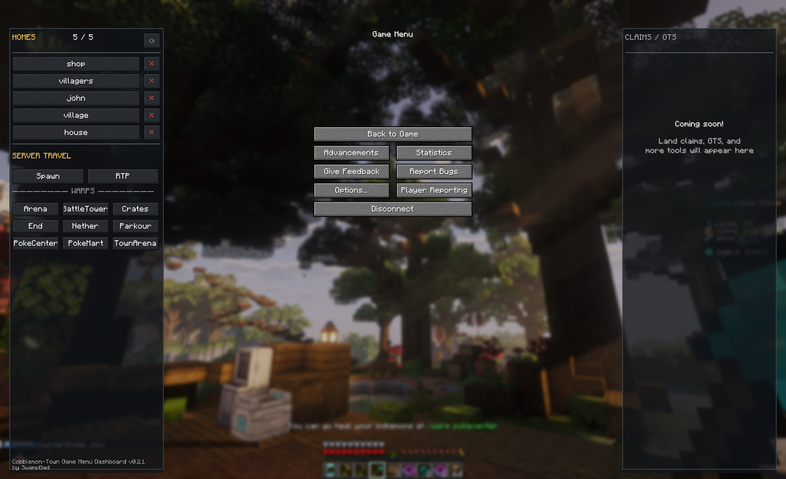

# Cobblemon Town Client Mods

Hi, I'm **SwampDad** in-game and **WGU Data Ninja** on GitHub.

I'm a Cobblemon Town player sharing unofficial client-side quality-of-life mods built
specifically for **Cobblemon Town and its modpack**. These are independent fan projects,
not official Cobblemon Town or Cobblemon releases.

**Cobblemon Town:** [Wiki](https://cobblemon-town.gitbook.io/cobblemon-town) · [CurseForge](https://www.curseforge.com/minecraft/modpacks/cobblemon-optimized-your-pokemon-journey) · [Modrinth](https://modrinth.com/modpack/cobblemon-town)

## Mods

These mods make existing actions easier to find, understand, and use without automating
gameplay or replacing server authority.

**Ground rule: One deliberate human action → at most one server action.**

They're built with the [Cobblemon Town Server Rules](https://cobblemon-town.gitbook.io/cobblemon-town/get-started/server-rules) in mind, especially the rules around automation and unfair advantages.

| Mod | What it does | Latest |
| --- | --- | --- |
| **Game Menu Dashboard** | Adds your Homes and useful Cobblemon Town server destinations directly to the Escape menu. | [**0.2.3-dev tester build**](game-menu-dashboard/release/) · [v0.2.1 GitHub Release](https://github.com/wguDataNinja/cobblemon-town-client-mods/releases/tag/game-menu-dashboard-v0.2.1) |
| **Trash Warning** | Makes Cobblemon Town's `/trash` clearly distinguishable from a normal chest so you don't accidentally throw something away. | [**v0.1.3**](https://github.com/wguDataNinja/cobblemon-town-client-mods/releases/tag/trash-warning-v0.1.3) |
| **Egg Badges** | Marks visible Pokémon Eggs with perfect 6×31 IVs with a small badge. | [Source and v0.2.4 release](https://github.com/SwampDad/egg-badges) |
| **PC Exporter** | Exports a read-only JSON snapshot of your Cobblemon PC from a button inside the PC screen, for breeding/team analysis. | [Source and v0.3.0 release](https://github.com/SwampDad/pc-exporter) |
| **Collection Exporter** | Creates a readable, copyable report of your Cobblemon PC collection, including Custom Skins, Legendary & Mythical, Shiny, and unresolved aspects. | [Source and 0.3.0-dev.1 tester release](https://github.com/SwampDad/collection-exporter) |

Each mod is independent. Install only the ones you want.

## Installation

These mods are client-side only. Nothing needs to be installed on the server.

1. Go to the mod's **latest GitHub Release**.
2. Under **Assets**, download the mod's `.jar` file.
3. Open the Minecraft instance you use for **Cobblemon Town**.
4. Place the downloaded `.jar` in that instance's `mods` folder.
5. Restart Minecraft.

### Updating

Download the new `.jar` and replace the old version in your `mods` folder. Do not leave
multiple versions of the same mod installed at the same time.

### Which file should I download?

Download the normal mod `.jar` listed under **Assets** on the GitHub Release. You do
not need source ZIPs, development JARs, or the GitHub repository itself.

## Compatibility

These mods are developed specifically for the **Cobblemon Town server and its modpack**.

- **Minecraft:** 1.21.1
- **Fabric Loader:** 0.18.0 or newer
- **Fabric API:** 0.116.7+1.21.1 or newer
- **Java:** 21 or newer
- **Server/modpack:** Cobblemon Town

The mods are client-side only and do not require server installation. Server or modpack
changes may affect compatibility; check each mod's latest release notes after updates.

## Game Menu Dashboard

**Game Menu Dashboard** turns Minecraft's Escape menu into a Cobblemon Town control
surface while preserving the normal vanilla Game Menu. The current release provides
Homes and Home capacity, click-to-travel Homes, Home creation/deletion/refresh, Spawn,
RTP, and direct access to the server's fixed travel Warps. Server actions still use the
normal commands available to the player.

### Screenshot



*Game Menu Dashboard v0.2.1 on Cobblemon Town.*

## Trash Warning

**Trash Warning** makes Cobblemon Town's `/trash` inventory visually unmistakable from
ordinary storage, reducing the chance of accidental deletion. It does not change the
server's Trash behavior.

## Egg Badges

**Egg Badges** adds a small visual marker to visible Pokémon Eggs with perfect six-stat
31 IVs. It does not modify Pokémon, Eggs, inventories, breeding mechanics, or server
state. Its source and releases now live at [SwampDad/egg-badges](https://github.com/SwampDad/egg-badges).

## PC Exporter

**PC Exporter** adds an **Export PC** button to the Cobblemon PC screen and writes a
private, timestamped JSON snapshot of your PC to your own computer, for breeding/team/build
analysis. It is read-only: no networking, no gameplay automation, no server commands, and no
inventory mutation. The snapshot stays local to your instance.

**PC Exporter requires Cobblemon PC Plus.** The button is placed inside the PC Plus
interface; install Cobblemon and Cobblemon PC Plus first.

Its source and releases now live at [SwampDad/pc-exporter](https://github.com/SwampDad/pc-exporter).

## Collection Exporter

**Collection Exporter** reads your client-synchronized Cobblemon PC and produces a readable
collection report you can copy to the clipboard. It groups Custom Skins by official family,
splits Legendary & Mythical, preserves Shiny status, and names unresolved aspects instead of
hiding them. It is read-only and does not require PC Plus or PC Exporter.

Its source and releases now live at [SwampDad/collection-exporter](https://github.com/SwampDad/collection-exporter).

## Scope

These are small client-side quality-of-life mods. They do not require server
installation, grant extra permissions, or replace server authority. Any ordinary server
action still goes through the normal command or interaction available to the player.

## Checksums

Published releases include a SHA-256 checksum for the release JAR. Most players do not
need it; it is provided for independent verification of a downloaded or copied JAR.

## Development

Each published mod maintains its own source, tests, version, release notes, and release
lifecycle.

```bash
cd trash-warning && ./gradlew test build
cd ../game-menu-dashboard && ./gradlew test build
cd ../collection-exporter && ./gradlew test build
```

Only remapped runtime JARs from `build/libs/` are intended for release.

## License

Unless a project directory states otherwise, these mods are distributed under the
repository's MIT License.
